# 视频转 AMV

把常见视频转换成 **AMV**（老式 MP4 播放器专用格式）或 **AVI** 的工具，包含三个版本：Android 4.4 原生版、Flutter Android 版、Flutter Windows 版。

AMV 输出完整支持 `amv` 视频编码 + `adpcm_ima_amv` 音频，可放进 160×128 ~ 320×240 的 8 种分辨率，适合老式随身听 / MP4 播放器。

## 下载

成品安装包见 [Releases](https://github.com/whr936689/video-to-amv/releases/latest)：

| 文件 | 说明 |
| --- | --- |
| `AMV-android4.4.apk` | Android 4.4 原生版（armeabi-v7a，内置 FFmpeg） |
| `AMV-arm64-release.apk` | Flutter Android 版（arm64） |
| `AMV-Windows.zip` | Flutter Windows 版，解压后运行 `amv_windows.exe` |

## 功能

- 8 种视频长宽：160×128、176×128、176×144、192×160、208×120、208×160、208×176、320×240
- 帧率 10 / 15 / 25 fps，画质 high / middle / low
- 画面变换：上下交换、左右交换、上下-左右交换、顺时针 / 逆时针旋转 90°
- 等比缩放 + 黑边填充，不拉伸画面
- 截取指定时间段
- 替换音轨（支持为无音轨视频自动补静音）
- 音视频同步选项
- 批量转换，每个文件单独显示进度
- 实时转换日志，可随时取消

## 运行截图

### Windows 版

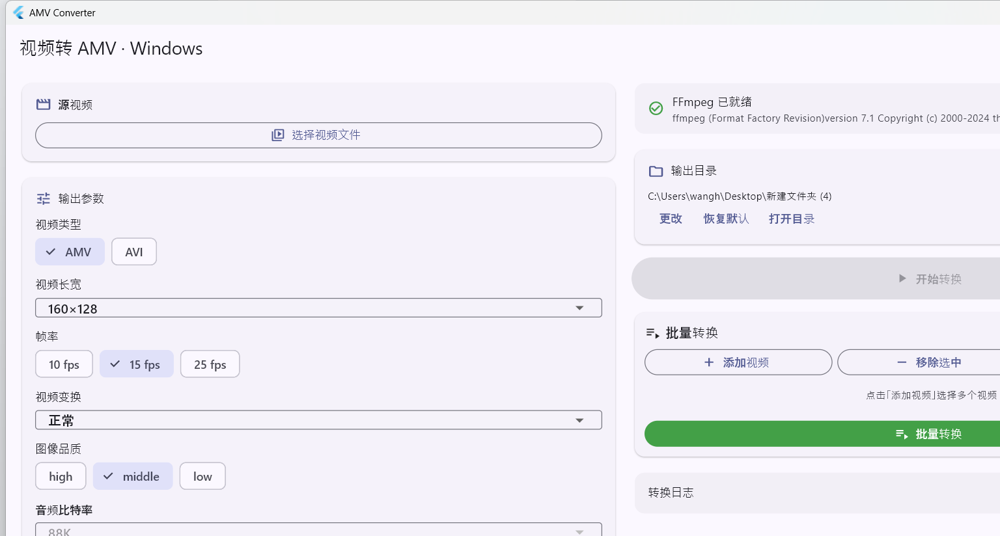

### Android 4.4 原生版

<p>
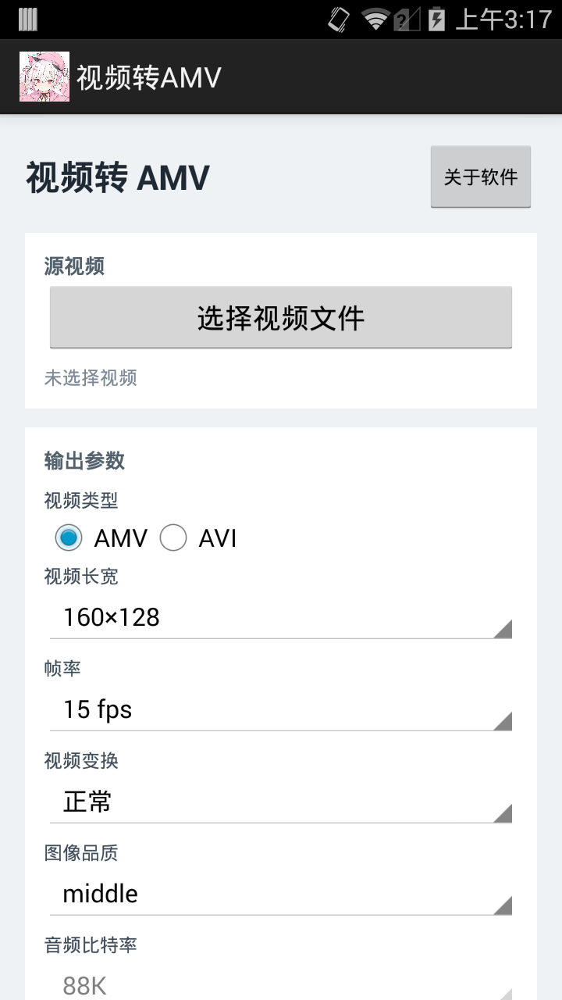
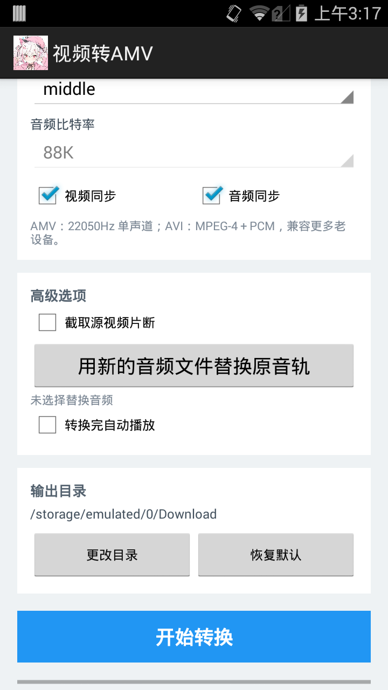
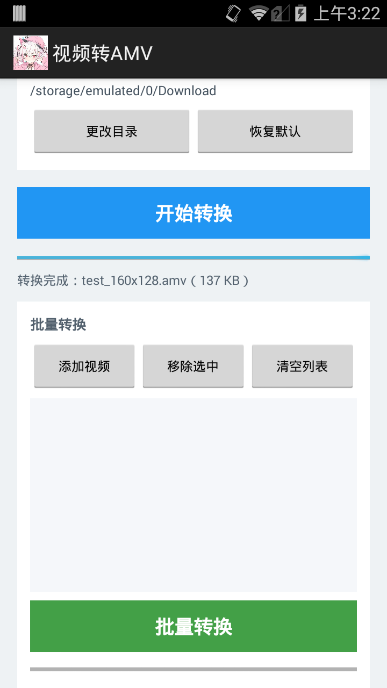

</p>

### Flutter Android 版

<p>
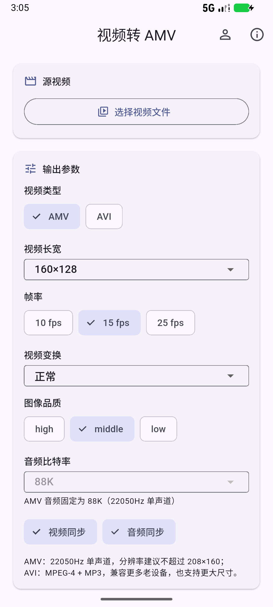
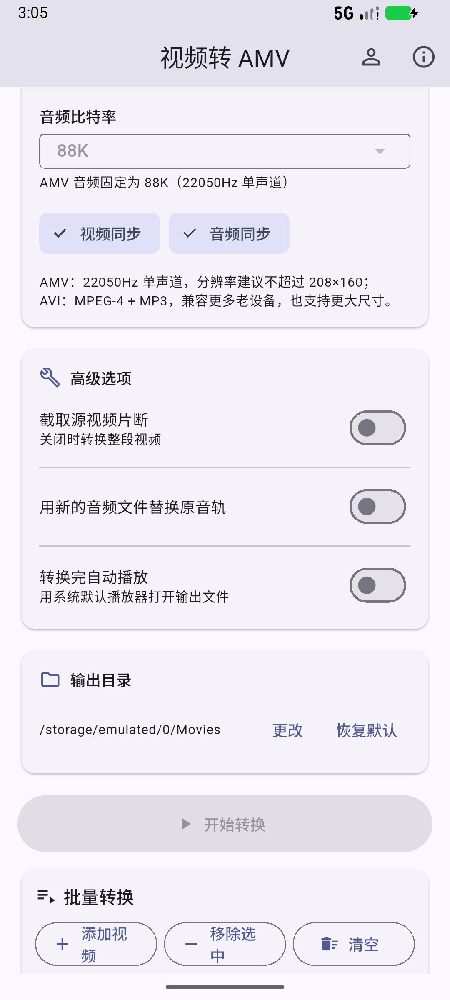
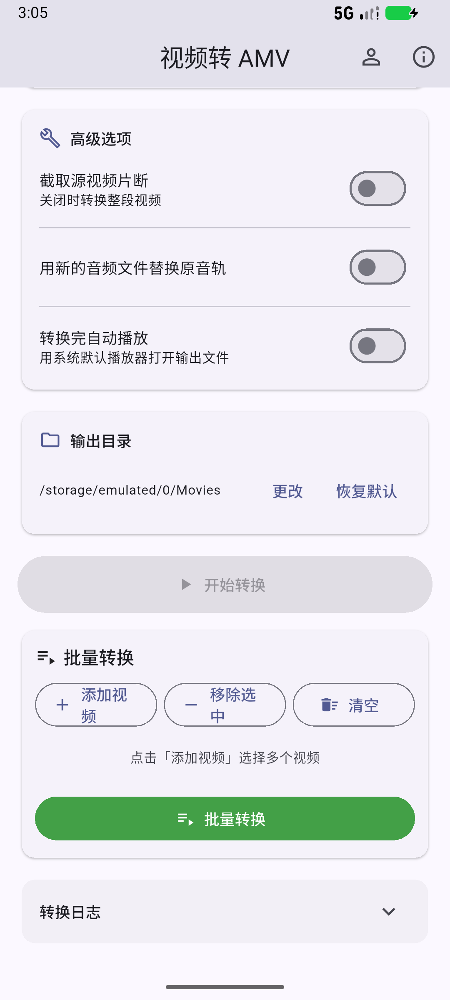
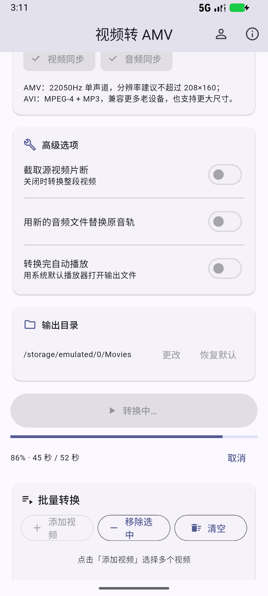
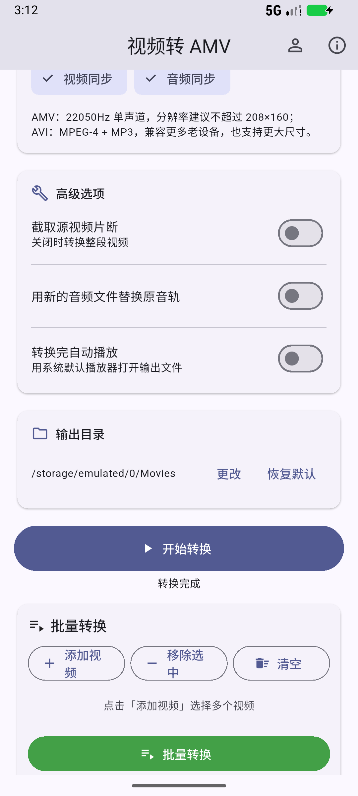
</p>

<p>
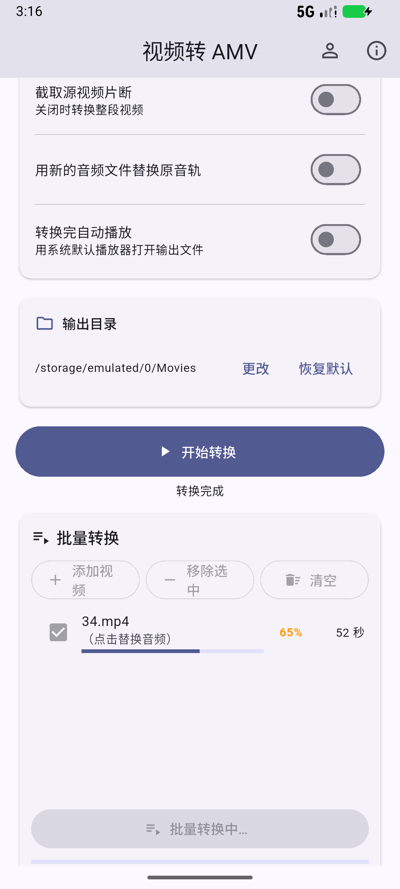
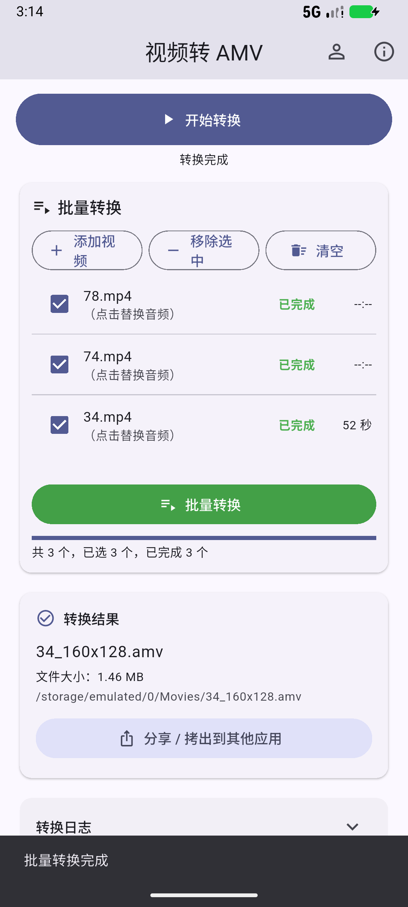
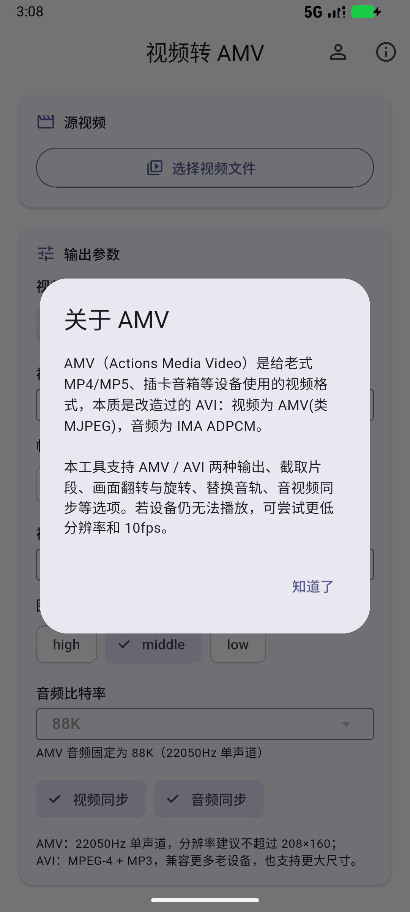
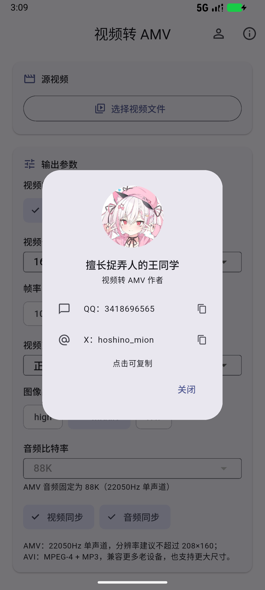
</p>

## 目录结构

| 目录 | 说明 |
| --- | --- |
| `amv_native` | Android 4.4 原生工程（Java + 内置 FFmpeg，支持 armeabi-v7a） |
| `amv_converter` | Flutter Android 版（ffmpeg-kit） |
| `amv_windows` | Flutter Windows 版（调用外部 FFmpeg） |
| `screenshots` | 运行截图 |

## Windows 版与 FFmpeg

Windows 版不自带 FFmpeg，程序会按以下顺序自动查找：

1. 程序目录下的 `ffmpeg.exe`
2. 系统 `PATH` 中的 `ffmpeg`
3. 常见安装位置（如 FormatFactory 自带目录）

如果都没有，点界面上的「选择 ffmpeg.exe」手动指定。**必须使用带 `amv` muxer 和 `adpcm_ima_amv` 编码器的完整版 FFmpeg**（gyan.dev 的 full build 即可），否则只能输出 AVI。程序启动时会显示 FFmpeg 版本并检测 AMV 支持情况。

## 构建

```bash
# Flutter Android
cd amv_converter && flutter build apk --release

# Flutter Windows（需要 Visual Studio 2022 + C++ 桌面开发工作负载）
cd amv_windows && flutter build windows --release
```

Android 4.4 原生版用 Gradle 构建：

```bash
cd amv_native && ./gradlew assembleRelease
```

## 作者

擅长捉弄人的王同学

- QQ：3418696565
- X：[@hoshino_mion](https://x.com/hoshino_mion)
